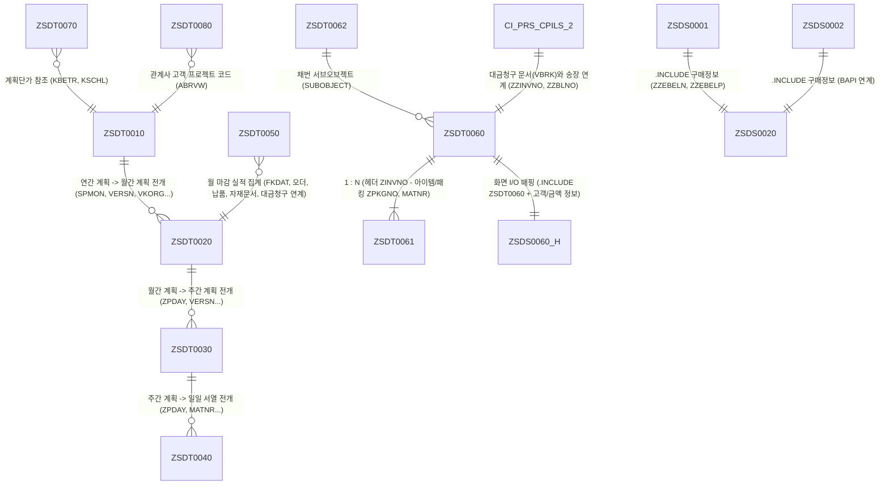

# 📘 SAP SD 모듈 데이터 딕셔너리 명세서 (Data Dictionary Specification)

> **문서 버전**: v1.0  
> **최종 수정일**: 2026-10-14  
> **시스템 / 모듈**: SAP ERP (S/4HANA) — SD (Sales & Distribution / 영업 및 유통)  
> **데이터 소스**: `dictionary` 폴더 내 SE11 추출 HTML (총 16개 객체)  
> **작성 목적**: SD 모듈 내 커스텀 테이블, 구조체, 확장 인클루드의 통합 데이터 명세 제공 및 개발·유지보수 표준 문서화  

---

## 1. 개요 및 구성 요약

본 명세서는 `dictionary` 디렉토리에 보관된 SAP ABAP Data Dictionary(SE11) 추출 정의서 파일(16개)을 기반으로 작성된 **SD 모듈 커스텀 데이터 딕셔너리 통합 명세서**입니다.

### 📊 업무 영역별 객체 분류

```
┌─────────────────────────────────────────────────────────────────────────────────┐
│                           SAP SD 커스텀 데이터 모델                              │
└──────────────────────────────────────┬──────────────────────────────────────────┘
                                       │
         ┌─────────────────────────────┼─────────────────────────────┐
         ▼                             ▼                             ▼
┌──────────────────┐          ┌──────────────────┐          ┌──────────────────┐
│ 1. 판매 계획 관리 │          │ 2. 상업송장/통관  │          │ 3. 영업 마감/인터 │
│ (Sales Planning) │          │(Commercial Inv)  │          │   페이스 및 BAPI  │
├──────────────────┤          ├──────────────────┤          ├──────────────────┤
│ ZSDT0010 (연간)  │          │ ZSDT0060 (헤더)  │          │ ZSDT0050 (마감)  │
│ ZSDT0020 (월간)  │          │ ZSDT0061 (아이템)│          │ ZSDS0001 (Append)│
│ ZSDT0030 (주간)  │          │ ZSDT0062 (채번)  │          │ ZSDS0002 (BAPI)  │
│ ZSDT0040 (일일)  │          │ ZSDS0060_H(화면) │          │ ZSDS0010 (리턴)  │
│ ZSDT0070 (단가)  │          │ CI_PRS_CPILS_2   │          │ ZSDS0020 (공통PO)│
│ ZSDT0080 (PJT코드)│         │                  │          │                  │
└──────────────────┘          └──────────────────┘          └──────────────────┘
```

1. **판매 계획 관리 (Sales Planning)** (6개 객체)
   - 중장기 연간 계획부터 월간, 주간, 일일 서열 수급계획까지 단계별로 전개되는 수량 계획 구조
   - 관계사 전용 계획단가 조건 레코드 및 프로젝트 코드 관리
2. **상업송장 / 통관 관리 (Commercial Invoice & Export)** (5개 객체)
   - 수출 및 출하에 수반되는 Commercial Invoice의 헤더(선적, 포워더, Incoterms, 결제조건 등) 및 아이템/패킹 내역 관리
   - 인보이스 번호 자동 채번을 위한 서브오브젝트 및 표준 대금청구 문서(VBRK/VBRP) 확장 구조 포함
3. **영업 마감 및 BAPI / 인터페이스 (Closing & Interface)** (5개 객체)
   - VMI/CMI 기반의 월 판매 마감 및 실적 정산 테이블
   - 판매문서(VBAK/VBAP) BAPI 연계 및 구매발주(PO) 매핑용 Append 구조체

---

## 2. 데이터 딕셔너리 오브젝트 총괄표 (Summary Matrix)

| No | 오브젝트명 | 오브젝트 유형 | 업무 영역 | 주요 설명 | 필드수 | Primary Key (복합 키 구성) | 원본 파일 |
|:--:|:---|:---|:---|:---|:--:|:---|:---|
| 1 | **CI_PRS_CPILS_2** | Customizing Include | 상업송장 / 통관 | [SD] 대금청구 확장 구조체 (송장번호, B/L 번호) | 2 | - | `ci_prs_cpils_2.html` |
| 2 | **ZSDS0001** | Structure | BAPI / 인터페이스 | [SD] 판매문서 Append 구조체 (구매발주 정보 연계) | 3 | - | `zsds0001.html` |
| 3 | **ZSDS0002** | Structure | BAPI / 인터페이스 | [SD] 판매문서 Append 구조체 (BAPE / BAPI 연계) | 3 | - | `zsds0002.html` |
| 4 | **ZSDS0010** | Structure | BAPI / 인터페이스 | [SD] 출고 반품 처리 결과 BAPI 리턴 메시지 구조체 | 3 | - | `zsds0010.html` |
| 5 | **ZSDS0020** | Structure | BAPI / 인터페이스 | [SD] 판매문서 구매정보 공통 인클루드 구조체 | 2 | - | `zsds0020.html` |
| 6 | **ZSDS0060_H** | Structure | 상업송장 / 통관 | [SD] Commercial Invoice 헤더 화면 I/O 구조체 | 48 | - | `zsds0060_h.html` |
| 7 | **ZSDT0010** | Transparent Table | 판매 계획 관리 | [SD] 연간 판매계획 관리 테이블 | 19 | `MANDT, SPMON, VERSN, ZSVER, ZYYMM, VKORG, VKBUR, VKGRP, MATNR` | `zsdt0010.html` |
| 8 | **ZSDT0020** | Transparent Table | 판매 계획 관리 | [SD] 월간 판매계획 관리 테이블 | 19 | `MANDT, SPMON, VERSN, ZSVER, ZYYMM, VKORG, VKBUR, VKGRP, MATNR` | `zsdt0020.html` |
| 9 | **ZSDT0030** | Transparent Table | 판매 계획 관리 | [SD] 주간 판매계획 관리 테이블 | 18 | `MANDT, PERID, ZSVER, ZPDAY, VKORG, VKBUR, VKGRP, MATNR` | `zsdt0030.html` |
| 10 | **ZSDT0040** | Transparent Table | 판매 계획 관리 | [SD] 일일 서열 수급계획 관리 테이블 | 15 | `MANDT, ZPDAY, VKORG, VKBUR, VKGRP, MATNR` | `zsdt0040.html` |
| 11 | **ZSDT0050** | Transparent Table | 영업 마감 | [SD] VMI/CMI 월 판매 마감 실적 및 정산 테이블 | 28 | `MANDT, FKDAT, VKORG, VKBUR, VKGRP, VTWEG, KUNAG, KUNWE, KUNRG, VBELN, POSNR` | `zsdt0050.html` |
| 12 | **ZSDT0060** | Transparent Table | 상업송장 / 통관 | [SD] Commercial Invoice 헤더 정보 관리 테이블 | 39 | `MANDT, ZINVNO` | `zsdt0060.html` |
| 13 | **ZSDT0061** | Transparent Table | 상업송장 / 통관 | [SD] Commercial Invoice 품목 및 패킹 정보 테이블 | 23 | `MANDT, ZINVNO, ZPKGNO, MATNR` | `zsdt0061.html` |
| 14 | **ZSDT0062** | Transparent Table | 상업송장 / 통관 | [SD] Commercial Invoice 채번 서브오브젝트 관리 테이블 | 9 | `MANDT, SUBOBJECT` | `zsdt0062.html` |
| 15 | **ZSDT0070** | Transparent Table | 판매 계획 관리 | [SD] 관계사 계획단가 조건 레코드 테이블 | 14 | `KSCHL, VKORG, MATNR, DATBI, DATAB` | `zsdt0070.html` |
| 16 | **ZSDT0080** | Transparent Table | 판매 계획 관리 | [SD] 관계사별 고객 프로젝트 코드 매핑 테이블 | 10 | `MANDT, KUNNR` | `zsdt0080.html` |

---

## 3. ER 다이어그램 및 업무 연계도 (Entity Relationship Diagram)



---

## 4. 공통 인클루드 규격 (Common Standards)

### 4.1. 변경이력 타임스탬프 공통 인클루드: `ZCMS0010`
시스템 내 거의 모든 마스터 및 트랜잭션 투명 테이블(`ZSDT0010` ~ `ZSDT0080`)의 말단에 공통으로 인클루드되어 생성자, 생성일시, 변경자, 변경일시를 기록합니다.

| 필드명 | 데이터 엘리먼트 | 도메인 | 타입 | 길이 | 설명 (한글 / 영문) |
|:---|:---|:---|:---:|:---:|:---|
| `ERDAT` | `ERDAT` | `DATUM` | DATS | 8 | 레코드 생성일자 (Record Created On) |
| `ERZET` | `ERZET` | `UZEIT` | TIMS | 6 | 레코드 생성시간 (Entry time) |
| `ERNAM` | `ERNAM` | `USNAM` | CHAR | 12 | 생성자 ID (Responsible Person) |
| `AEDAT` | `AEDAT` | `DATUM` | DATS | 8 | 최종 변경일자 (Last Changed On) |
| `AEZET` | `AEZET` | `UZEIT` | TIMS | 6 | 최종 변경시간 (Time last change was made) |
| `AENAM` | `AENAM` | `USNAM` | CHAR | 12 | 최종 변경자 ID (Changed by) |

### 4.2. 판매문서 구매정보 공통 인클루드: `ZSDS0020`
영업 오더(Sales Order) 및 출하/납품 시 고객 발주(PO) 기반의 구매문서 번호 및 품목번호를 연계하기 위한 표준 확장 인클루드 구조체입니다. `ZSDS0001`, `ZSDS0002`에 공통 인클루드됩니다.

| 필드명 | 데이터 엘리먼트 | 도메인 | 타입 | 길이 | 설명 (한글 / 영문) |
|:---|:---|:---|:---:|:---:|:---|
| `ZZEBELN` | `EBELN` | `EBELN` | CHAR | 10 | 구매 오더 번호 (Purchasing Document Number) |
| `ZZEBELP` | `EBELP` | `EBELP` | NUMC | 5 | 구매 오더 품목 번호 (Item Number of Purchasing Document) |

---

## 5. 객체별 상세 명세서 (Detailed Specifications)

---

### 📁 1. 판매 계획 관리 (Sales Planning)

---

#### 🔹 ZSDT0010 : [SD] Annual Sales Plan (연간 판매계획)

- **오브젝트명**: `ZSDT0010`
- **오브젝트 유형**: 투명 테이블 (Transparent Table)
- **영문 설명**: `[SD] Annual Sales Plan`
- **Primary Key**: `MANDT`, `SPMON`, `VERSN`, `ZSVER`, `ZYYMM`, `VKORG`, `VKBUR`, `VKGRP`, `MATNR`
- **원본 추출 파일**: `dictionary/zsdt0010.html`

**[ 필드 정의 목록 ]**

| No | 필드명 | PK | 데이터 엘리먼트 | 도메인 | 타입 | 길이 | 소문자 | 필드 설명 (Domain Text) |
|:--:|:---|:--:|:---|:---|:---:|:---:|:---:|:---|
| 1 | `MANDT` | 🔑 PK | MANDT | MANDT | CLNT | 3 | | 클라이언트 (Client) |
| 2 | `SPMON` | 🔑 PK | SPMON | MCPERIOD | NUMC | 6 | | 분석 기간 - 월 (Period to analyze - month, YYYYMM) |
| 3 | `VERSN` | 🔑 PK | VERSN | COVERSI | CHAR | 3 | | 계획 버전 (Version) |
| 4 | `ZSVER` | 🔑 PK | ZESVER | ZDSVER | CHAR | 1 | | [SD] 판매계획 확정구분 (Sales Planning Version) |
| 5 | `ZYYMM` | 🔑 PK | | | CHAR | 6 | | 판매계획 년월 (Sales Planning Period, YYYYMM) |
| 6 | `VKORG` | 🔑 PK | VKORG | VKORG | CHAR | 4 | | 영업 조직 (Sales Organization) |
| 7 | `VKBUR` | 🔑 PK | VKBUR | VKBUR | CHAR | 4 | | 영업소 (Sales Office) |
| 8 | `VKGRP` | 🔑 PK | VKGRP | VKGRP | CHAR | 3 | | 영업 그룹 (Sales Group) |
| 9 | `MATNR` | 🔑 PK | MATNR | MATNR | CHAR | 40 | | 자재 번호 (Material Number) |
| 10 | `ZNETW` | | | | DEC | 15 | | 판매 계획 수량 (Sales Planning Quantity) |
| 11 | `MEINS` | | MEINS | MEINS | UNIT | 3 | Y | 기본 단위 (Base Unit of Measure) |
| 12 | `ZPPFG` | | | | CHAR | 1 | | 생산계획 연계 플래그 (Production Planning Flag) |
| 13 | 📌 `.INCLUDE` | | `ZCMS0010` | | | 0 | | [CM] Time stamp 변경이력 공통 인클루드 |
| 14 | `ERDAT` | | ERDAT | DATUM | DATS | 8 | | 생성일자 (Record Created On) |
| 15 | `ERZET` | | ERZET | UZEIT | TIMS | 6 | | 생성시간 (Entry time) |
| 16 | `ERNAM` | | ERNAM | USNAM | CHAR | 12 | | 생성자 (Responsible Person) |
| 17 | `AEDAT` | | AEDAT | DATUM | DATS | 8 | | 최종 변경일자 (Last Changed On) |
| 18 | `AEZET` | | AEZET | UZEIT | TIMS | 6 | | 최종 변경시간 (Time last change was made) |
| 19 | `AENAM` | | AENAM | USNAM | CHAR | 12 | | 최종 변경자 (Name of Person Who Changed Object) |

**[ 도메인 고정값 (Fixed Domain Values) ]**

| 도메인명 | 값 (Value Low) | 값 (Value High) | 내역 설명 |
|:---|:---:|:---:|:---|
| `ZDSVER` | `1` | | Incomplete (미확정/작성중) |
| `ZDSVER` | `2` | | Complete (확정완료) |

---

#### 🔹 ZSDT0020 : [SD] Monthly Sales Plan (월간 판매계획)

- **오브젝트명**: `ZSDT0020`
- **오브젝트 유형**: 투명 테이블 (Transparent Table)
- **영문 설명**: `[SD] Monthly Sales Plan`
- **Primary Key**: `MANDT`, `SPMON`, `VERSN`, `ZSVER`, `ZYYMM`, `VKORG`, `VKBUR`, `VKGRP`, `MATNR`
- **원본 추출 파일**: `dictionary/zsdt0020.html`

**[ 필드 정의 목록 ]**

| No | 필드명 | PK | 데이터 엘리먼트 | 도메인 | 타입 | 길이 | 소문자 | 필드 설명 (Domain Text) |
|:--:|:---|:--:|:---|:---|:---:|:---:|:---:|:---|
| 1 | `MANDT` | 🔑 PK | MANDT | MANDT | CLNT | 3 | | 클라이언트 (Client) |
| 2 | `SPMON` | 🔑 PK | SPMON | MCPERIOD | NUMC | 6 | | 분석 기간 - 월 (Period to analyze - month, YYYYMM) |
| 3 | `VERSN` | 🔑 PK | VERSN | COVERSI | CHAR | 3 | | 계획 버전 (Version) |
| 4 | `ZSVER` | 🔑 PK | ZESVER | ZDSVER | CHAR | 1 | | [SD] 판매계획 확정구분 (Sales Planning Version) |
| 5 | `ZYYMM` | 🔑 PK | | | CHAR | 6 | | 판매계획 년월 (Sales Planning Period, YYYYMM) |
| 6 | `VKORG` | 🔑 PK | VKORG | VKORG | CHAR | 4 | | 영업 조직 (Sales Organization) |
| 7 | `VKBUR` | 🔑 PK | VKBUR | VKBUR | CHAR | 4 | | 영업소 (Sales Office) |
| 8 | `VKGRP` | 🔑 PK | VKGRP | VKGRP | CHAR | 3 | | 영업 그룹 (Sales Group) |
| 9 | `MATNR` | 🔑 PK | MATNR | MATNR | CHAR | 40 | | 자재 번호 (Material Number) |
| 10 | `ZNETW` | | | | DEC | 15 | | 판매 계획 수량 (Sales Planning Quantity) |
| 11 | `MEINS` | | MEINS | MEINS | UNIT | 3 | Y | 기본 단위 (Base Unit of Measure) |
| 12 | `ZPPFG` | | | | CHAR | 1 | | 생산계획 연계 플래그 (Production Planning Flag) |
| 13 | 📌 `.INCLUDE` | | `ZCMS0010` | | | 0 | | [CM] Time stamp 변경이력 공통 인클루드 |
| 14 | `ERDAT` | | ERDAT | DATUM | DATS | 8 | | 생성일자 (Record Created On) |
| 15 | `ERZET` | | ERZET | UZEIT | TIMS | 6 | | 생성시간 (Entry time) |
| 16 | `ERNAM` | | ERNAM | USNAM | CHAR | 12 | | 생성자 (Responsible Person) |
| 17 | `AEDAT` | | AEDAT | DATUM | DATS | 8 | | 최종 변경일자 (Last Changed On) |
| 18 | `AEZET` | | AEZET | UZEIT | TIMS | 6 | | 최종 변경시간 (Time last change was made) |
| 19 | `AENAM` | | AENAM | USNAM | CHAR | 12 | | 최종 변경자 (Name of Person Who Changed Object) |

**[ 도메인 고정값 (Fixed Domain Values) ]**

| 도메인명 | 값 (Value Low) | 값 (Value High) | 내역 설명 |
|:---|:---:|:---:|:---|
| `ZDSVER` | `1` | | Incomplete (미확정/작성중) |
| `ZDSVER` | `2` | | Complete (확정완료) |

---

#### 🔹 ZSDT0030 : [SD] Weekly Sales Plan (주간 판매계획)

- **오브젝트명**: `ZSDT0030`
- **오브젝트 유형**: 투명 테이블 (Transparent Table)
- **영문 설명**: `[SD] Weekly Sales Plan`
- **Primary Key**: `MANDT`, `PERID`, `ZSVER`, `ZPDAY`, `VKORG`, `VKBUR`, `VKGRP`, `MATNR`
- **원본 추출 파일**: `dictionary/zsdt0030.html`

**[ 필드 정의 목록 ]**

| No | 필드명 | PK | 데이터 엘리먼트 | 도메인 | 타입 | 길이 | 소문자 | 필드 설명 (Domain Text) |
|:--:|:---|:--:|:---|:---|:---:|:---:|:---:|:---|
| 1 | `MANDT` | 🔑 PK | MANDT | MANDT | CLNT | 3 | | 클라이언트 (Client) |
| 2 | `PERID` | 🔑 PK | | | CHAR | 7 | | 계획 기간 - 년도/주차 (Planning Period: Year/Week, e.g. 2026/42) |
| 3 | `ZSVER` | 🔑 PK | ZESVER | ZDSVER | CHAR | 1 | | [SD] 판매계획 확정구분 (Sales Planning Version) |
| 4 | `ZPDAY` | 🔑 PK | | | CHAR | 8 | | 계획 일자 (Sales Planning Period, YYYYMMDD) |
| 5 | `VKORG` | 🔑 PK | VKORG | VKORG | CHAR | 4 | | 영업 조직 (Sales Organization) |
| 6 | `VKBUR` | 🔑 PK | VKBUR | VKBUR | CHAR | 4 | | 영업소 (Sales Office) |
| 7 | `VKGRP` | 🔑 PK | VKGRP | VKGRP | CHAR | 3 | | 영업 그룹 (Sales Group) |
| 8 | `MATNR` | 🔑 PK | MATNR | MATNR | CHAR | 40 | | 자재 번호 (Material Number) |
| 9 | `ZNETW` | | | | DEC | 15 | | 판매 계획 수량 (Sales Planning Quantity) |
| 10 | `MEINS` | | MEINS | MEINS | UNIT | 3 | Y | 기본 단위 (Base Unit of Measure) |
| 11 | `ZPPFG` | | | | CHAR | 1 | | 생산계획 연계 플래그 (Production Planning Flag) |
| 12 | 📌 `.INCLUDE` | | `ZCMS0010` | | | 0 | | [CM] Time stamp 변경이력 공통 인클루드 |
| 13 | `ERDAT` | | ERDAT | DATUM | DATS | 8 | | 생성일자 (Record Created On) |
| 14 | `ERZET` | | ERZET | UZEIT | TIMS | 6 | | 생성시간 (Entry time) |
| 15 | `ERNAM` | | ERNAM | USNAM | CHAR | 12 | | 생성자 (Responsible Person) |
| 16 | `AEDAT` | | AEDAT | DATUM | DATS | 8 | | 최종 변경일자 (Last Changed On) |
| 17 | `AEZET` | | AEZET | UZEIT | TIMS | 6 | | 최종 변경시간 (Time last change was made) |
| 18 | `AENAM` | | AENAM | USNAM | CHAR | 12 | | 최종 변경자 (Name of Person Who Changed Object) |

**[ 도메인 고정값 (Fixed Domain Values) ]**

| 도메인명 | 값 (Value Low) | 값 (Value High) | 내역 설명 |
|:---|:---:|:---:|:---|
| `ZDSVER` | `1` | | Incomplete (미확정/작성중) |
| `ZDSVER` | `2` | | Complete (확정완료) |

---

#### 🔹 ZSDT0040 : [SD] Daily Sequence Supply-Demand Plan (일일 서열 수급계획)

- **오브젝트명**: `ZSDT0040`
- **오브젝트 유형**: 투명 테이블 (Transparent Table)
- **영문 설명**: `[SD] Daily Sequence Supply-Demand Plan`
- **Primary Key**: `MANDT`, `ZPDAY`, `VKORG`, `VKBUR`, `VKGRP`, `MATNR`
- **원본 추출 파일**: `dictionary/zsdt0040.html`

**[ 필드 정의 목록 ]**

| No | 필드명 | PK | 데이터 엘리먼트 | 도메인 | 타입 | 길이 | 소문자 | 필드 설명 (Domain Text) |
|:--:|:---|:--:|:---|:---|:---:|:---:|:---:|:---|
| 1 | `MANDT` | 🔑 PK | MANDT | MANDT | CLNT | 3 | | 클라이언트 (Client) |
| 2 | `ZPDAY` | 🔑 PK | | | CHAR | 8 | | 수급계획 일자 (Sales Planning Period, YYYYMMDD) |
| 3 | `VKORG` | 🔑 PK | VKORG | VKORG | CHAR | 4 | | 영업 조직 (Sales Organization) |
| 4 | `VKBUR` | 🔑 PK | VKBUR | VKBUR | CHAR | 4 | | 영업소 (Sales Office) |
| 5 | `VKGRP` | 🔑 PK | VKGRP | VKGRP | CHAR | 3 | | 영업 그룹 (Sales Group) |
| 6 | `MATNR` | 🔑 PK | MATNR | MATNR | CHAR | 40 | | 자재 번호 (Material Number) |
| 7 | `ZNETW` | | | | DEC | 15 | | 판매 계획 수량 (Sales Planning Quantity) |
| 8 | `MEINS` | | MEINS | MEINS | UNIT | 3 | Y | 기본 단위 (Base Unit of Measure) |
| 9 | 📌 `.INCLUDE` | | `ZCMS0010` | | | 0 | | [CM] Time stamp 변경이력 공통 인클루드 |
| 10 | `ERDAT` | | ERDAT | DATUM | DATS | 8 | | 생성일자 (Record Created On) |
| 11 | `ERZET` | | ERZET | UZEIT | TIMS | 6 | | 생성시간 (Entry time) |
| 12 | `ERNAM` | | ERNAM | USNAM | CHAR | 12 | | 생성자 (Responsible Person) |
| 13 | `AEDAT` | | AEDAT | DATUM | DATS | 8 | | 최종 변경일자 (Last Changed On) |
| 14 | `AEZET` | | AEZET | UZEIT | TIMS | 6 | | 최종 변경시간 (Time last change was made) |
| 15 | `AENAM` | | AENAM | USNAM | CHAR | 12 | | 최종 변경자 (Name of Person Who Changed Object) |

---

#### 🔹 ZSDT0070 : [SD] Affiliated Company Planning Price (관계사 계획단가)

- **오브젝트명**: `ZSDT0070`
- **오브젝트 유형**: 투명 테이블 (Transparent Table)
- **영문 설명**: `[SD] Affiliated Company Planning Price`
- **Primary Key**: `KSCHL`, `VKORG`, `MATNR`, `DATBI`, `DATAB`
- **원본 추출 파일**: `dictionary/zsdt0070.html`

**[ 필드 정의 목록 ]**

| No | 필드명 | PK | 데이터 엘리먼트 | 도메인 | 타입 | 길이 | 소문자 | 필드 설명 (Domain Text) |
|:--:|:---|:--:|:---|:---|:---:|:---:|:---:|:---|
| 1 | `KSCHL` | 🔑 PK | KSCHA | KSCHL | CHAR | 4 | | 가격 조건 유형 (Condition Type, 예: PR00 등) |
| 2 | `VKORG` | 🔑 PK | VKORG | VKORG | CHAR | 4 | | 영업 조직 (Sales Organization) |
| 3 | `MATNR` | 🔑 PK | MATNR | MATNR | CHAR | 40 | | 자재 번호 (Material Number) |
| 4 | `DATBI` | 🔑 PK | KODATBI | DATUM | DATS | 8 | | 효력 종료일 (Validity end date of condition) |
| 5 | `DATAB` | 🔑 PK | KODATAB | DATUM | DATS | 8 | | 효력 시작일 (Validity start date of condition) |
| 6 | `KBETR` | | KBETR_KOND | WERTV6 | CURR | 11 | | 조건 단가/금액 (Condition amount or percentage) |
| 7 | `KONWA` | | KONWA | WAERS | CUKY | 5 | | 통화 단위 (Condition Unit: Currency / Percentage) |
| 8 | 📌 `.INCLUDE` | | `ZCMS0010` | | | 0 | | [CM] Time stamp 변경이력 공통 인클루드 |
| 9 | `ERDAT` | | ERDAT | DATUM | DATS | 8 | | 생성일자 (Record Created On) |
| 10 | `ERZET` | | ERZET | UZEIT | TIMS | 6 | | 생성시간 (Entry time) |
| 11 | `ERNAM` | | ERNAM | USNAM | CHAR | 12 | | 생성자 (Responsible Person) |
| 12 | `AEDAT` | | AEDAT | DATUM | DATS | 8 | | 최종 변경일자 (Last Changed On) |
| 13 | `AEZET` | | AEZET | UZEIT | TIMS | 6 | | 최종 변경시간 (Time last change was made) |
| 14 | `AENAM` | | AENAM | USNAM | CHAR | 12 | | 최종 변경자 (Name of Person Who Changed Object) |

---

#### 🔹 ZSDT0080 : [SD] Project Code By Affiliated Company (관계사별 프로젝트 코드)

- **오브젝트명**: `ZSDT0080`
- **오브젝트 유형**: 투명 테이블 (Transparent Table)
- **영문 설명**: `[SD] Project Code By Affiliated Company`
- **Primary Key**: `MANDT`, `KUNNR`
- **원본 추출 파일**: `dictionary/zsdt0080.html`

**[ 필드 정의 목록 ]**

| No | 필드명 | PK | 데이터 엘리먼트 | 도메인 | 타입 | 길이 | 소문자 | 필드 설명 (Domain Text) |
|:--:|:---|:--:|:---|:---|:---:|:---:|:---:|:---|
| 1 | `MANDT` | 🔑 PK | MANDT | MANDT | CLNT | 3 | | 클라이언트 (Client) |
| 2 | `KUNNR` | 🔑 PK | KUNNR | KUNNR | CHAR | 10 | | 고객 번호 (Customer Number) |
| 3 | `ABRVW` | | ZABRVW | ABRVW | CHAR | 3 | | 사용 목적 / 프로젝트 코드 (Usage Indicator / Project Code) |
| 4 | 📌 `.INCLUDE` | | `ZCMS0010` | | | 0 | | [CM] Time stamp 변경이력 공통 인클루드 |
| 5 | `ERDAT` | | ERDAT | DATUM | DATS | 8 | | 생성일자 (Record Created On) |
| 6 | `ERZET` | | ERZET | UZEIT | TIMS | 6 | | 생성시간 (Entry time) |
| 7 | `ERNAM` | | ERNAM | USNAM | CHAR | 12 | | 생성자 (Responsible Person) |
| 8 | `AEDAT` | | AEDAT | DATUM | DATS | 8 | | 최종 변경일자 (Last Changed On) |
| 9 | `AEZET` | | AEZET | UZEIT | TIMS | 6 | | 최종 변경시간 (Time last change was made) |
| 10 | `AENAM` | | AENAM | USNAM | CHAR | 12 | | 최종 변경자 (Name of Person Who Changed Object) |

---

### 📁 2. 상업송장 / 통관 관리 (Commercial Invoice)

---

#### 🔹 ZSDT0060 : [SD] Commercial Invoice Information (상업송장 헤더 정보)

- **오브젝트명**: `ZSDT0060`
- **오브젝트 유형**: 투명 테이블 (Transparent Table)
- **영문 설명**: `[SD] Commercial Inovoice Information`
- **Primary Key**: `MANDT`, `ZINVNO`
- **원본 추출 파일**: `dictionary/zsdt0060.html`

**[ 필드 정의 목록 ]**

| No | 필드명 | PK | 데이터 엘리먼트 | 도메인 | 타입 | 길이 | 소문자 | 필드 설명 (Domain Text) |
|:--:|:---|:--:|:---|:---|:---:|:---:|:---:|:---|
| 1 | `MANDT` | 🔑 PK | MANDT | MANDT | CLNT | 3 | | 클라이언트 (Client) |
| 2 | `ZINVNO` | 🔑 PK | | | CHAR | 20 | | 상업 송장 번호 (Commercial Inv Number) |
| 3 | `ZIVH01` | | | | CHAR | 500 | | 납품처 위치 (Ship to Location) |
| 4 | `ZIVH02` | | | | CHAR | 100 | | 수하인 위치 (Consignee Location) |
| 5 | `ZIVH03` | | | | CHAR | 100 | | 대금청구처 위치 (Bill to Location) |
| 6 | `ZIVH04` | | | | CHAR | 100 | | 통지처 1 (Notify Party 1) |
| 7 | `ZIVH05` | | | | CHAR | 100 | | 통지처 2 (Notify Party 2) |
| 8 | `ZIVH06` | | | | CHAR | 240 | | 비고 1 (Remarks 1) |
| 9 | `ZIVH07` | | | | CHAR | 240 | | 비고 2 (Remarks 2) |
| 10 | `ZIVH08` | | | | CHAR | 240 | | 하우스 운송장 번호 (House Waybill) |
| 11 | `ZIVH09` | | | | CHAR | 30 | | 선적항 (Port of Loading) |
| 12 | `ZIVH10` | | | | CHAR | 30 | | 항차 번호 (Voyage No) |
| 13 | `ZIVH11` | | | | DATS | 8 | | 선적 일자 (On Board Date) |
| 14 | `ZIVH12` | | | | CHAR | 10 | | 포장 단위 (Package) |
| 15 | `ZIVH13` | | NTGEW | MENG13 | QUAN | 13 | | 순중량 (Net Weight) |
| 16 | `ZIVH14` | | | | CHAR | 500 | | 선적 비고 (Shipping Remark) |
| 17 | `ZIVH15` | | | | DATS | 8 | | 송장 일자 (Date of Invoice) |
| 18 | `ZIVH16` | | | | CHAR | 30 | | 마스터 운송장 번호 (Master Waybill) |
| 19 | `ZIVH17` | | | | CHAR | 30 | | 도착항/양하항 (Discharging Port) |
| 20 | `ZIVH18` | | | | CHAR | 30 | | 운임 조건 (Freight Terms) |
| 21 | `ZIVH19` | | | | DATS | 8 | | 도착 예정일 (ETA Date) |
| 22 | `ZIVH20` | | | | CHAR | 10 | | 포장 수량 단위 (Package) |
| 23 | `ZIVH21` | | BRGEW | MENG13 | QUAN | 13 | | 총중량 (Gross Weight) |
| 24 | `ZIVH22` | | DZTERM | ZTERM | CHAR | 4 | | 지급조건 키 (Terms of Payment Key) |
| 25 | `ZIVH23` | | | | CHAR | 240 | | 포워더/운송 주선인 (Forwarder) |
| 26 | `ZIVH24` | | | | CHAR | 240 | | 목적지 (Destination) |
| 27 | `ZIVH25` | | INCO1 | INCO1 | CHAR | 3 | | 인코텀즈 1부 (Incoterms Part 1, 예: FOB, CIF 등) |
| 28 | `ZIVH26` | | | | CHAR | 30 | | 운송 방식 (Shipping Method) |
| 29 | `ZIVH27` | | VOLUM | MENG13 | QUAN | 13 | | 부피 (Volume) |
| 30 | `ZIVH28` | | ZESDPACKTYP | ZDSDPACKTYP | CHAR | 2 | | [SD] 포장 유형 코드 (Pack Type) |
| 31 | `VBELN_VL` | | VBELN_VL | VBELN | CHAR | 10 | | 납품문서 번호 (Delivery Document) |
| 32 | `MEINS` | | MEINS | MEINS | UNIT | 3 | Y | 기본 단위 (Base Unit of Measure) |
| 33 | 📌 `.INCLUDE` | | `ZCMS0010` | | | 0 | | [CM] Time stamp 변경이력 공통 인클루드 |
| 34 | `ERDAT` | | ERDAT | DATUM | DATS | 8 | | 생성일자 (Record Created On) |
| 35 | `ERZET` | | ERZET | UZEIT | TIMS | 6 | | 생성시간 (Entry time) |
| 36 | `ERNAM` | | ERNAM | USNAM | CHAR | 12 | | 생성자 (Responsible Person) |
| 37 | `AEDAT` | | AEDAT | DATUM | DATS | 8 | | 최종 변경일자 (Last Changed On) |
| 38 | `AEZET` | | AEZET | UZEIT | TIMS | 6 | | 최종 변경시간 (Time last change was made) |
| 39 | `AENAM` | | AENAM | USNAM | CHAR | 12 | | 최종 변경자 (Name of Person Who Changed Object) |

**[ 도메인 고정값 (Fixed Domain Values: ZDSDPACKTYP) ]**

| 도메인명 | 값 (Value Low) | 값 (Value High) | 내역 설명 |
|:---|:---:|:---:|:---|
| `ZDSDPACKTYP` | `01` | | AMPLIFIER |
| `ZDSDPACKTYP` | `02` | | AMPLIFER & LOUD SPEAKER |
| `ZDSDPACKTYP` | `03` | | FABRIC |
| `ZDSDPACKTYP` | `04` | | HEADPHONE |
| `ZDSDPACKTYP` | `05` | | LOUD SPEAKER |
| `ZDSDPACKTYP` | `06` | | LOUD SPEAKER & SPEAKER PARTS |
| `ZDSDPACKTYP` | `07` | | MACHINE AND EQUIPMENT |
| `ZDSDPACKTYP` | `08` | | MICROPHONE |
| `ZDSDPACKTYP` | `09` | | PARTS FOR SPEAKER |
| `ZDSDPACKTYP` | `10` | | SPEAKER UNIT |

---

#### 🔹 ZSDT0061 : [SD] Commercial Invoice Item Information (상업송장 품목/패킹 정보)

- **오브젝트명**: `ZSDT0061`
- **오브젝트 유형**: 투명 테이블 (Transparent Table)
- **영문 설명**: `[SD] Commercial Invoice Item Information`
- **Primary Key**: `MANDT`, `ZINVNO`, `ZPKGNO`, `MATNR`
- **원본 추출 파일**: `dictionary/zsdt0061.html`

**[ 필드 정의 목록 ]**

| No | 필드명 | PK | 데이터 엘리먼트 | 도메인 | 타입 | 길이 | 소문자 | 필드 설명 (Domain Text) |
|:--:|:---|:--:|:---|:---|:---:|:---:|:---:|:---|
| 1 | `MANDT` | 🔑 PK | MANDT | MANDT | CLNT | 3 | | 클라이언트 (Client) |
| 2 | `ZINVNO` | 🔑 PK | | | CHAR | 20 | | 상업 송장 번호 (Commercial Inv Number) |
| 3 | `ZPKGNO` | 🔑 PK | | | CHAR | 10 | | 패킹 번호 (Pack NO) |
| 4 | `MATNR` | 🔑 PK | MATNR | MATNR | CHAR | 40 | | 자재 번호 (Material Number) |
| 5 | `ZIVI01` | | LFIMG | MENG13 | QUAN | 13 | | 실제 납품 수량 (Actual quantity delivered in sales units) |
| 6 | `ZIVI02` | | | | INT4 | 10 | | 단위 수량 (U/T Qty) |
| 7 | `ZIVI03` | | | | INT4 | 10 | | 카톤 수량 (C/T Qty) |
| 8 | `ZIVI04` | | NTGEW | MENG13 | QUAN | 13 | | 순중량 (Net Weight) |
| 9 | `ZIVI05` | | BRGEW | MENG13 | QUAN | 13 | | 총중량 (Gross Weight) |
| 10 | `ZIVI06` | | VOLUM | MENG13 | QUAN | 13 | | 부피 (Volume) |
| 11 | `MEINS` | | MEINS | MEINS | UNIT | 3 | Y | 기본 단위 (Base Unit of Measure) |
| 12 | `VBELN_VL` | | VBELN_VL | VBELN | CHAR | 10 | | 납품문서 번호 (Delivery) |
| 13 | `POSNR` | | POSNR | POSNR | NUMC | 6 | | 납품 품목 번호 (Item number of SD document) |
| 14 | `NETPR` | | | | DEC | 15 | | 순단가 (Net Value in Document Currency) |
| 15 | `NETWR` | | NETWR | WERTV8 | CURR | 15 | | 순금액 (Net Value in Document Currency) |
| 16 | `WAERS` | | WAERK | WAERS | CUKY | 5 | | 통화 단위 (SD Document Currency) |
| 17 | 📌 `.INCLUDE` | | `ZCMS0010` | | | 0 | | [CM] Time stamp 변경이력 공통 인클루드 |
| 18 | `ERDAT` | | ERDAT | DATUM | DATS | 8 | | 생성일자 (Record Created On) |
| 19 | `ERZET` | | ERZET | UZEIT | TIMS | 6 | | 생성시간 (Entry time) |
| 20 | `ERNAM` | | ERNAM | USNAM | CHAR | 12 | | 생성자 (Responsible Person) |
| 21 | `AEDAT` | | AEDAT | DATUM | DATS | 8 | | 최종 변경일자 (Last Changed On) |
| 22 | `AEZET` | | AEZET | UZEIT | TIMS | 6 | | 최종 변경시간 (Time last change was made) |
| 23 | `AENAM` | | AENAM | USNAM | CHAR | 12 | | 최종 변경자 (Name of Person Who Changed Object) |

---

#### 🔹 ZSDT0062 : [SD] Commercial Invoice Number Subobject (채번 서브오브젝트)

- **오브젝트명**: `ZSDT0062`
- **오브젝트 유형**: 투명 테이블 (Transparent Table)
- **영문 설명**: `[SD] Commercial Invoice Number Subobject`
- **Primary Key**: `MANDT`, `SUBOBJECT`
- **원본 추출 파일**: `dictionary/zsdt0062.html`

**[ 필드 정의 목록 ]**

| No | 필드명 | PK | 데이터 엘리먼트 | 도메인 | 타입 | 길이 | 소문자 | 필드 설명 (Domain Text) |
|:--:|:---|:--:|:---|:---|:---:|:---:|:---:|:---|
| 1 | `MANDT` | 🔑 PK | MANDT | MANDT | CLNT | 3 | | 클라이언트 (Client) |
| 2 | `SUBOBJECT` | 🔑 PK | ZE_SD_INV_SUB | ZD_SD_INV_SUB | CHAR | 4 | | [SD] 인보이스 채번 서브오브젝트 코드 |
| 3 | 📌 `.INCLUDE` | | `ZCMS0010` | | | 0 | | [CM] Time stamp 변경이력 공통 인클루드 |
| 4 | `ERDAT` | | ERDAT | DATUM | DATS | 8 | | 생성일자 (Record Created On) |
| 5 | `ERZET` | | ERZET | UZEIT | TIMS | 6 | | 생성시간 (Entry time) |
| 6 | `ERNAM` | | ERNAM | USNAM | CHAR | 12 | | 생성자 (Responsible Person) |
| 7 | `AEDAT` | | AEDAT | DATUM | DATS | 8 | | 최종 변경일자 (Last Changed On) |
| 8 | `AEZET` | | AEZET | UZEIT | TIMS | 6 | | 최종 변경시간 (Time last change was made) |
| 9 | `AENAM` | | AENAM | USNAM | CHAR | 12 | | 최종 변경자 (Name of Person Who Changed Object) |

---

#### 🔹 ZSDS0060_H : [SD] Commercial Invoice Header Screen (화면 입출력 구조체)

- **오브젝트명**: `ZSDS0060_H`
- **오브젝트 유형**: 구조체 (Structure)
- **영문 설명**: `[SD] Commercial Invoice Header Screen`
- **Primary Key**: 없음 (구조체)
- **원본 추출 파일**: `dictionary/zsds0060_h.html`

**[ 필드 정의 목록 ]**

| No | 필드명 | PK | 데이터 엘리먼트 | 도메인 | 타입 | 길이 | 소문자 | 필드 설명 (Domain Text) |
|:--:|:---|:--:|:---|:---|:---:|:---:|:---:|:---|
| 1 | 📌 `.INCLUDE` | | `ZSDT0060` | | | 0 | | [SD] Commercial Invoice 헤더 테이블 인클루드 |
| 2 | `MANDT` | | MANDT | MANDT | CLNT | 3 | | 클라이언트 |
| 3 | `ZINVNO` | | | | CHAR | 20 | | 상업 송장 번호 |
| 4~31 | `ZIVH01` ~ `ZIVH28` | | | | | | | 상업 송장 헤더 제반 정보 (위치, 비고, 운송, 중량 등) |
| 32 | `VBELN_VL` | | VBELN_VL | VBELN | CHAR | 10 | | 납품문서 번호 |
| 33 | `MEINS` | | MEINS | MEINS | UNIT | 3 | Y | 기본 단위 |
| 34 | 📌 `.INCLUDE` | | `ZCMS0010` | | | 0 | | [CM] Time stamp 변경이력 공통 인클루드 |
| 35~40 | `ERDAT` ~ `AENAM` | | | | | | | 생성/변경 타임스탬프 필드 그룹 |
| 41 | `KUNAG` | | KUNAG | KUNNR | CHAR | 10 | | 주문 고객 (Sold-to Party) |
| 42 | `CUSTOMER_NAME` | | NAME1_GP | NAME | CHAR | 35 | | 고객명 (Name 1) |
| 43 | `KUNNR` | | KUNNR | KUNNR | CHAR | 10 | | 고객 번호 (Customer Number) |
| 44 | `LFART` | | LFART | LFART | CHAR | 4 | | 납품 유형 (Delivery Type) |
| 45 | `LFART_TEXT` | | CHAR40 | CHAR40 | CHAR | 40 | | 납품 유형 명칭 (Description) |
| 46 | `TOTAL_AMOUNT` | | NETWR | WERTV8 | CURR | 15 | | 총 인보이스 금액 (Net Value in Document Currency) |
| 47 | `WAERK` | | WAERK | WAERS | CUKY | 5 | | 통화 키 (SD Document Currency) |
| 48 | `IMPORT_INVNO` | | AWKEY | AWKEY | CHAR | 20 | | 수입/참조 송장 번호 (Reference Key) |

**[ 도메인 고정값 (Fixed Domain Values: ZDSDPACKTYP) ]**
- `ZSDT0060`과 동일 (01: AMPLIFIER ~ 10: SPEAKER UNIT)

---

#### 🔹 CI_PRS_CPILS_2 : [SD] Billing Extension (대금청구 확장 구조체)

- **오브젝트명**: `CI_PRS_CPILS_2`
- **오브젝트 유형**: 커스터마이징 인클루드 (Customizing Include)
- **영문 설명**: `[SD] Billing Extension`
- **Primary Key**: 없음 (구조체)
- **원본 추출 파일**: `dictionary/ci_prs_cpils_2.html`

**[ 필드 정의 목록 ]**

| No | 필드명 | PK | 데이터 엘리먼트 | 도메인 | 타입 | 길이 | 소문자 | 필드 설명 (Domain Text) |
|:--:|:---|:--:|:---|:---|:---:|:---:|:---:|:---|
| 1 | `ZZINVNO` | | | | CHAR | 20 | | 상업 송장 번호 (Commercial Inv Number) |
| 2 | `ZZBLNO` | | | | CHAR | 20 | | 선하증권 번호 (BL Number) |

---

### 📁 3. 영업 마감 및 BAPI / 인터페이스 (Closing & BAPI Interface)

---

#### 🔹 ZSDT0050 : [SD] VMI/CMI Monthly Sales Closing (VMI/CMI 월 판매 마감 실적)

- **오브젝트명**: `ZSDT0050`
- **오브젝트 유형**: 투명 테이블 (Transparent Table)
- **영문 설명**: `[SD] VMI/CMI Mothly Sales Closing`
- **Primary Key**: `MANDT`, `FKDAT`, `VKORG`, `VKBUR`, `VKGRP`, `VTWEG`, `KUNAG`, `KUNWE`, `KUNRG`, `VBELN`, `POSNR`
- **원본 추출 파일**: `dictionary/zsdt0050.html`

**[ 필드 정의 목록 ]**

| No | 필드명 | PK | 데이터 엘리먼트 | 도메인 | 타입 | 길이 | 소문자 | 필드 설명 (Domain Text) |
|:--:|:---|:--:|:---|:---|:---:|:---:|:---:|:---|
| 1 | `MANDT` | 🔑 PK | MANDT | MANDT | CLNT | 3 | | 클라이언트 (Client) |
| 2 | `FKDAT` | 🔑 PK | FKDAT | DATUM | DATS | 8 | | 대금청구 일자 / 마감일자 (Billing Date) |
| 3 | `VKORG` | 🔑 PK | VKORG | VKORG | CHAR | 4 | | 영업 조직 (Sales Organization) |
| 4 | `VKBUR` | 🔑 PK | VKBUR | VKBUR | CHAR | 4 | | 영업소 (Sales Office) |
| 5 | `VKGRP` | 🔑 PK | VKGRP | VKGRP | CHAR | 3 | | 영업 그룹 (Sales Group) |
| 6 | `VTWEG` | 🔑 PK | VTWEG | VTWEG | CHAR | 2 | | 유통 경로 (Distribution Channel) |
| 7 | `KUNAG` | 🔑 PK | KUNAG | KUNNR | CHAR | 10 | | 주문 고객 (Sold-to Party) |
| 8 | `KUNWE` | 🔑 PK | KUNWE | KUNNR | CHAR | 10 | | 납품처 (Ship-to Party) |
| 9 | `KUNRG` | 🔑 PK | KUNRG | KUNNR | CHAR | 10 | | 지급처 (Payer) |
| 10 | `VBELN` | 🔑 PK | VBELN | VBELN | CHAR | 10 | | 영업문서 번호 (Sales Document Number) |
| 11 | `POSNR` | 🔑 PK | POSNR | POSNR | NUMC | 6 | | 영업문서 품목 번호 (Item number of SD document) |
| 12 | `MATNR` | | MATNR | MATNR | CHAR | 40 | | 자재 번호 (Material Number) |
| 13 | `KWMENG` | | KWMENG | MENG15 | QUAN | 15 | | 누적 오더 수량 (Cumulative order quantity in sales units) |
| 14 | `MEINS` | | MEINS | MEINS | UNIT | 3 | Y | 판매 기본 단위 (Base Unit of Measure) |
| 15 | `NETPR` | | NETPR | WERTV6 | CURR | 11 | | 순단가 (Net Price) |
| 16 | `KPEIN` | | KPEIN | KPEIN | DEC | 5 | | 단가 기준 단위 (Condition Pricing Unit) |
| 17 | `WAERK` | | WAERK | WAERS | CUKY | 5 | | 통화 단위 (SD Document Currency) |
| 18 | `BSTKD` | | BSTKD | BSTKD | CHAR | 35 | | 고객 주문 참조 번호 (Customer Reference / PO No) |
| 19 | `VBELN_VL` | | VBELN_VL | VBELN | CHAR | 10 | | 납품문서 번호 (Delivery Document) |
| 20 | `MBLNR` | | MBLNR | BELNR | CHAR | 10 | | 자재 출고 문서 번호 (Number of Material Document) |
| 21 | `VBELN_VF` | | VBELN_VF | VBELN | CHAR | 10 | | 대금청구 문서 번호 (Billing Document) |
| 22 | 📌 `.INCLUDE` | | `ZCMS0010` | | | 0 | | [CM] Time stamp 변경이력 공통 인클루드 |
| 23 | `ERDAT` | | ERDAT | DATUM | DATS | 8 | | 생성일자 (Record Created On) |
| 24 | `ERZET` | | ERZET | UZEIT | TIMS | 6 | | 생성시간 (Entry time) |
| 25 | `ERNAM` | | ERNAM | USNAM | CHAR | 12 | | 생성자 (Responsible Person) |
| 26 | `AEDAT` | | AEDAT | DATUM | DATS | 8 | | 최종 변경일자 (Last Changed On) |
| 27 | `AEZET` | | AEZET | UZEIT | TIMS | 6 | | 최종 변경시간 (Time last change was made) |
| 28 | `AENAM` | | AENAM | USNAM | CHAR | 12 | | 최종 변경자 (Name of Person Who Changed Object) |

---

#### 🔹 ZSDS0001 : [SD] Sales Document Append Structure (판매문서 구매 연계)

- **오브젝트명**: `ZSDS0001`
- **오브젝트 유형**: 구조체 (Structure / VBAP Append)
- **영문 설명**: `[SD] Sales Document Append Structure`
- **Primary Key**: 없음 (구조체)
- **원본 추출 파일**: `dictionary/zsds0001.html`

**[ 필드 정의 목록 ]**

| No | 필드명 | PK | 데이터 엘리먼트 | 도메인 | 타입 | 길이 | 소문자 | 필드 설명 (Domain Text) |
|:--:|:---|:--:|:---|:---|:---:|:---:|:---:|:---|
| 1 | 📌 `.INCLUDE` | | `ZSDS0020` | | | 0 | | [SD] Sales Document Purchasing Common |
| 2 | `ZZEBELN` | | EBELN | EBELN | CHAR | 10 | | 구매 발주 번호 (Purchasing Document Number) |
| 3 | `ZZEBELP` | | EBELP | EBELP | NUMC | 5 | | 구매 발주 품목 번호 (Item Number of Purchasing Document) |

---

#### 🔹 ZSDS0002 : [SD] Sales Document Append Structure for BAPI (BAPE 연계)

- **오브젝트명**: `ZSDS0002`
- **오브젝트 유형**: 구조체 (Structure / BAPI Extension)
- **영문 설명**: `[SD] Sales Document Append Structure for bape / BAPI`
- **Primary Key**: 없음 (구조체)
- **원본 추출 파일**: `dictionary/zsds0002.html`

**[ 필드 정의 목록 ]**

| No | 필드명 | PK | 데이터 엘리먼트 | 도메인 | 타입 | 길이 | 소문자 | 필드 설명 (Domain Text) |
|:--:|:---|:--:|:---|:---|:---:|:---:|:---:|:---|
| 1 | 📌 `.INCLUDE` | | `ZSDS0020` | | | 0 | | [SD] Sales Document Purchasing Common |
| 2 | `ZZEBELN` | | EBELN | EBELN | CHAR | 10 | | 구매 발주 번호 (Purchasing Document Number) |
| 3 | `ZZEBELP` | | EBELP | EBELP | NUMC | 5 | | 구매 발주 품목 번호 (Item Number of Purchasing Document) |

---

#### 🔹 ZSDS0010 : [SD] Goods Issue Return (출고 반품 결과 메시지 구조체)

- **오브젝트명**: `ZSDS0010`
- **오브젝트 유형**: 구조체 (Structure)
- **영문 설명**: `[SD] Goods Issue return`
- **Primary Key**: 없음 (구조체)
- **원본 추출 파일**: `dictionary/zsds0010.html`

**[ 필드 정의 목록 ]**

| No | 필드명 | PK | 데이터 엘리먼트 | 도메인 | 타입 | 길이 | 소문자 | 필드 설명 (Domain Text) |
|:--:|:---|:--:|:---|:---|:---:|:---:|:---:|:---|
| 1 | `VBELN_VL` | | VBELN_VL | VBELN | CHAR | 10 | | 납품문서 번호 (Delivery Document) |
| 2 | `TYPE` | | BAPI_MTYPE | SYCHAR01 | CHAR | 1 | | 메시지 유형 (S: Success, E: Error, W: Warning, I: Info, A: Abort) |
| 3 | `MESSAGE` | | BAPI_MSG | TEXT220 | CHAR | 220 | | 처리 결과 메시지 텍스트 (Message Text) |

---

#### 🔹 ZSDS0020 : [SD] Sales Document Purchasing Common (구매 공통 구조체)

- **오브젝트명**: `ZSDS0020`
- **오브젝트 유형**: 구조체 (Structure)
- **영문 설명**: `[SD] Sales Document Purchasing Common`
- **Primary Key**: 없음 (구조체)
- **원본 추출 파일**: `dictionary/zsds0020.html`

**[ 필드 정의 목록 ]**

| No | 필드명 | PK | 데이터 엘리먼트 | 도메인 | 타입 | 길이 | 소문자 | 필드 설명 (Domain Text) |
|:--:|:---|:--:|:---|:---|:---:|:---:|:---:|:---|
| 1 | `ZZEBELN` | | EBELN | EBELN | CHAR | 10 | | 구매 발주 번호 (Purchasing Document Number) |
| 2 | `ZZEBELP` | | EBELP | EBELP | NUMC | 5 | | 구매 발주 품목 번호 (Item Number of Purchasing Document) |

---

## 6. 결론 및 개발 시 권장 가이드

1. **테이블 키 무결성 및 인덱스 활용**:
   - `ZSDT0010` ~ `ZSDT0040`의 판매계획 계층은 `VKORG`, `VKBUR`, `VKGRP`, `MATNR`, `SPMON`/`ZPDAY`가 결합된 복합 키를 사용하므로 대량 데이터 처리 시 반드시 선행 키 조건을 누락하지 않고 `SELECT` 구문을 구성해야 합니다.
2. **상업송장(Commercial Invoice) 처리 시 주의사항**:
   - `ZSDT0060` (헤더)와 `ZSDT0061` (아이템)은 `ZINVNO`로 연결되며, 화면 구조체인 `ZSDS0060_H`를 매핑하여 `ZSDR0150` 리포트 및 송장 처리 프로그램에서 데이터를 입출력합니다.
   - 송장 채번은 `ZSDT0062` 서브오브젝트를 통해 일관된 채번 규칙을 유지해야 합니다.
3. **타임스탬프 공통 모듈 연계**:
   - 데이터 생성/수정 시 `.INCLUDE ZCMS0010`의 변경자(`ERNAM`, `AENAM`), 변경일시(`ERDAT`/`ERZET`, `AEDAT`/`AEZET`)를 자동으로 갱신하기 위해 공통 유틸리티 클래스인 `ZCL_CM_UTIL`의 타임스탬프 메서드를 적극 활용합니다.